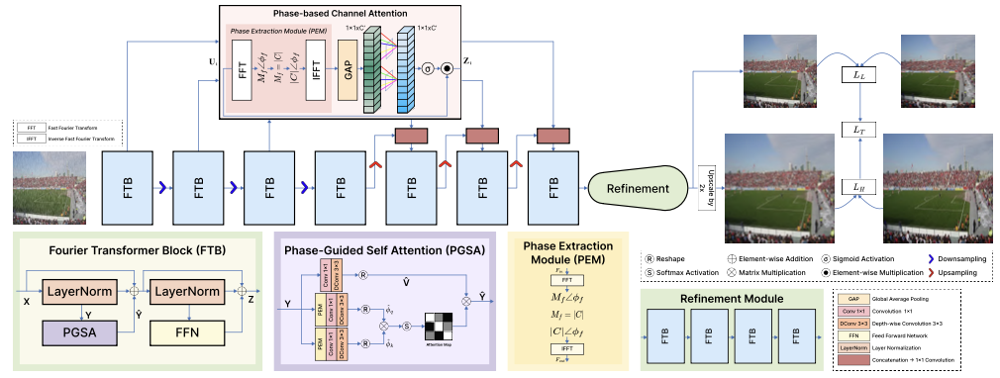

<p align="center">
  <h1 align="center">PhaseIR: Phase-Guided Attention Mechanism for Efficient Image Restoration</h1>
  <p align="center">
    <a href="">Abhinav Rajput</a>
    ·
    <a href="">Pihu Agrawal</a>
    ·
    <a href="">Xiaoyu Cao</a>
    ·
    <a href="">Xingjian Li</a>
    .
    <a href="">Min Xu</a>
  </p>
</p>



Image restoration is a fundamental low-level vision task that aims to recover high-quality images from degraded observations. Such degradations adversely affect the performance of downstream computer vision tasks. To address this, we propose PhaseIR, a lightweight phase-guided transformer with 26M parameters for efficient image restoration. We introduce a phase-guided self-attention mechanism that leverages Fourier phase information to learn meaningful image features. We also introduce a phase-based channel attention block that selectively propagates informative structural features through skip connections. Furthermore, we employ an adaptive multi-loss optimization strategy to improve reconstruction quality. Extensive ablation studies and comparative analyses demonstrate that PhaseIR achieves state-of-the-art performance across diverse image restoration tasks, including image deraining, single-image motion deblurring, defocus deblurring (single-image and dual-pixel data), and image denoising (Gaussian grayscale/color denoising, and real image denoising).

## ⚙️ Installation & Environment Setup

### 1. Clone the Repository
```bash
git clone https://github.com/shyyshawarma/PhaseIR-Phase-Guided-Attention-Mechanism-for-Efficient-Image-Restoration.git
cd PhaseIR-Phase-Guided-Attention-Mechanism-for-Efficient-Image-Restoration
```

### 2. Create a Conda Environment
```bash
conda create -n phaseir python=3.9 -y
conda activate phaseir
```

### 3. Install Dependencies
Install PyTorch matching your CUDA version (example for CUDA 11.8):
```bash
pip install torch torchvision --index-url https://download.pytorch.org/whl/cu118
```

Install additional requirements:
```bash
pip install numpy scipy pillow opencv-python kornia pytorch-msssim thop typing-extensions
```

